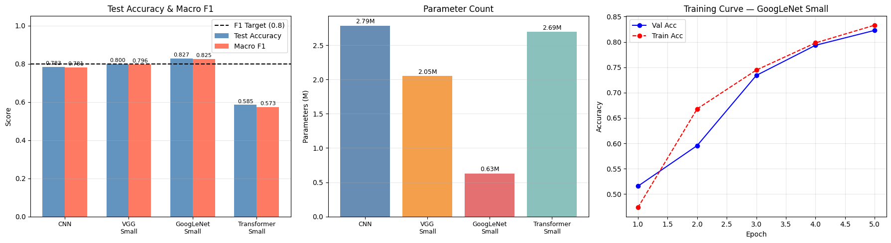
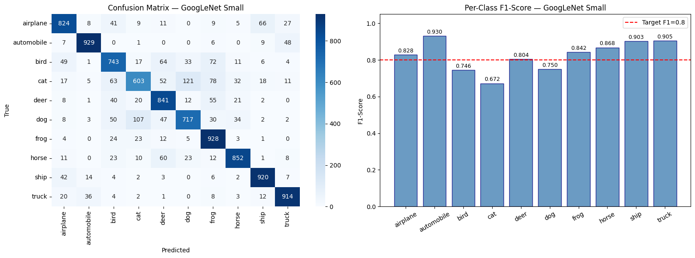

# CIFAR-10 Image Classification — MLP vs CNN vs VGG vs GoogLeNet vs Vision Transformer

Five image classifiers built from scratch in **PyTorch** and trained under the same budget
(**5 epochs, Adam, cross-entropy**) to compare how architecture — not parameter count — drives accuracy on CIFAR-10.

**Result:** a compact **GoogLeNet-style Inception network (0.63M parameters)** is the best model:
**82.7% test accuracy, macro F1 0.825** — beating models with 3–4× more parameters. (Course target: macro F1 ≥ 0.80 — only GoogLeNet reached it within the 5-epoch budget.)



## Setup

- **Data:** CIFAR-10 (60,000 32×32 colour images, 10 classes), downloaded automatically by `torchvision`
- **Split:** 45,000 train / 5,000 validation (held out from the training set, seed 42) / 10,000 test
- **Augmentation:** random crop (padding 4) + horizontal flip
- **Training:** 5 epochs, batch 128, Adam, cross-entropy (fixed by the assignment), mixed precision (AMP), gradient clipping, `torch.compile` when available
- **Metric:** test accuracy and **macro F1** (target ≥ 0.80)

## Models

| Model | Key ideas | Params | Test acc. | Macro F1 |
|---|---|---:|---:|---:|
| MLP baseline | Flattened pixels → fully connected layers with BatchNorm + dropout | 2.00M | 0.438 | 0.429 |
| CNN | Residual blocks + squeeze-and-excitation (SE) channel attention | 2.79M | 0.783 | 0.781 |
| VGG Small | Stacked 3×3 conv blocks with residual shortcuts | 2.05M | 0.800 | 0.796 |
| **GoogLeNet Small** | **Inception modules (parallel 1×1 / 3×3 / 5×5 / pooling branches)** | **0.63M** | **0.827** | **0.825** |
| Transformer Small | Vision Transformer: patch embedding, 8 layers, dim 192, warm-up, stochastic depth | 2.69M | 0.585 | 0.573 |

## Findings

- **Inductive bias beats size.** GoogLeNet Small has the fewest parameters of the convolutional models yet the best score;
  across the four non-MLP models, parameter count and macro F1 are negatively correlated (r = −0.58).
- **Transformers need more data or epochs.** Without convolutional priors the ViT learns slowly and reaches only 57% F1 in 5 epochs.
- **Hardest classes are animals that look alike:** cat (F1 0.67), bird (0.75) and dog (0.75); most errors are cat↔dog and bird/cat → frog.
  Vehicles are easiest (automobile 0.93, truck 0.91, ship 0.90).
- No model overfits within 5 epochs (validation loss tracks training loss), so longer training would likely improve all models.



## Repository structure

```
notebooks/cifar10_architecture_comparison.ipynb   # full pipeline: data, 5 models, training, evaluation, error analysis
figures/                                          # charts exported from the notebook
requirements.txt
```

The notebook's comments and headings are in Korean (course project); outputs, charts and this README are in English.

## How to run

```bash
pip install -r requirements.txt
jupyter notebook notebooks/cifar10_architecture_comparison.ipynb
```

A CUDA GPU is recommended (each model trains in 2.5–6 minutes on a GPU). CIFAR-10 is downloaded into `./data` on first run.

## Tech stack

Python · PyTorch · torchvision · scikit-learn · NumPy · pandas · Matplotlib · Seaborn
